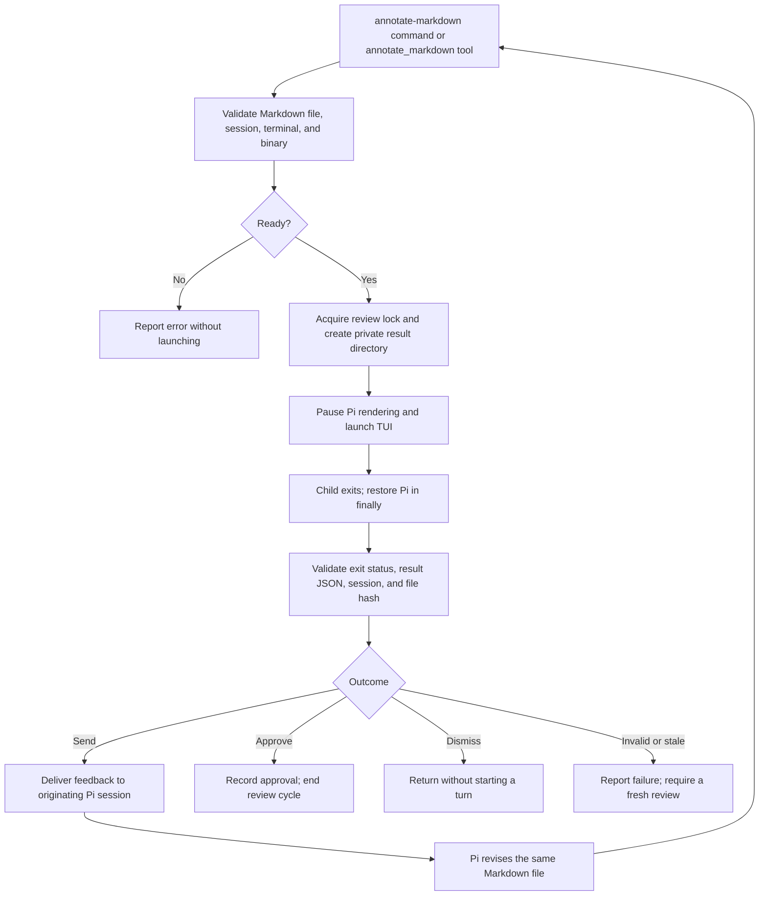

# Pi Markdown Annotator implementation plan

Status: implementation plan; no extension code exists yet.

## Goal and agreed approach

Build a Pi extension that opens a Markdown file for terminal-based annotation, returns the human's feedback to the same Pi session, and asks Pi to revise the file and submit it again. It must work in an interactive SSH session on a headless server without a browser, display server, Herdr, or a second pane.

The extension owns commands, agent tools, terminal handoff, result validation, and feedback delivery. The existing `plannotator-tui` binary provides the annotation interface as a child process. Users invoke the extension from Pi, not a separate application themselves.

### First-version scope

- Extension name: **Pi Markdown Annotator**.
- `/annotate-markdown <path>` for a human-triggered review.
- `annotate_markdown({ filePath })` for an agent-triggered review.
- One existing `.md`, `.markdown`, or `.mdx` file per review, one review at a time per Pi process. These are rendered as Markdown; MDX component execution is not supported.
- Reject other text formats and binary files with a Markdown-only error. The upstream single-file loader accepts UTF-8 files, but always interprets them as Markdown; it has no faithful plain-text/source-code mode.
- Full-terminal handoff, followed by restoration of Pi's interface.
- Send requests revision and another review; Approve ends the cycle; Dismiss closes quietly.
- An external, explicitly installed `plannotator-tui` dependency. No automatic binary downloads.

No code-diff review, folder review, transcript discovery, browser fallback, implementation-plan execution engine, or background pane management in the first version. Reviewing a document does not grant permission to execute the work it describes.

## Research evidence

These paths refer to the pinned submodule revisions, not whatever upstream publishes later.

| Source | What it establishes |
| --- | --- |
| `research/pi/packages/coding-agent/examples/extensions/interactive-shell.ts` | Uses `ctx.ui.custom()`, `tui.stop()`, inherited terminal streams, then `tui.start()` and `requestRender(true)` to run an interactive child. |
| `research/pi/packages/coding-agent/src/core/extensions/types.ts` | Command registration, tool execution mode, `terminate`, session lifecycle events, follow-up messages, and persistence APIs. |
| `research/plannotator-tui/crates/plannotator-tui/src/cli.rs` | Gated file review requires terminal stdout; supports a result file rather than stdout capture. |
| `research/plannotator-tui/crates/plannotator-tui/src/gate.rs` | `approved`, `annotated`, and `dismissed` decisions; strict JSON format, exit codes, and atomic no-overwrite result publication. |
| `research/plannotator-tui/crates/plannotator-tui/src/app/send.rs` | In gate mode, successful Send ends the review with one decision. |
| `research/plannotator-tui/skills/plannotator-tui/SKILL.md` | Existing agent-to-review workflow is Herdr-specific. Our extension replaces that delivery dependency, not the renderer. |
| `research/plannotator/apps/pi-extension/index.ts` | A working pattern for registering annotate commands/tools and returning review feedback with `deliverAs: "followUp"`. |
| `research/plannotator/apps/pi-extension/annotate-outcome.ts` | Approval with notes differs from revision feedback; closing without feedback should not start a new turn. |
| `research/plannotator/apps/pi-extension/current-pi-session.ts` | Motivation for checking session ownership before delivering delayed results. |

Pinned revisions at planning time:

- Pi: `70ca8e8960b4f05faf1affd752e6231ba6087605`.
- Plannotator: `4c78000316a16dba0c4b060d235c315ceb86a83d`.
- Plannotator TUI: `83b0cd91e287df391d5b27029140ff72c32c085d` (`v0.9.9`).

The APIs exist in these sources. Terminal behavior and follow-up ordering still need a real Pi integration spike; source inspection is not a passing runtime test. Set the package's Pi compatibility floor only after checking the installed host against the APIs we actually use.

## Entry points and file selection

### Slash command

```text
/annotate-markdown docs/plan.md
/annotate-markdown "docs/design plan.md"
```

Pi supplies the trailing text to `registerCommand("annotate-markdown").handler(args, ctx)`. Parse exactly one path, with optional matching single or double quotes. Preserve spaces inside quoted paths. Reject missing paths, unmatched quotes, and extra unquoted arguments with usage information. Do not evaluate shell syntax, expand environment variables, or execute substitutions.

Resolve relative paths against `ctx.cwd`; accept absolute paths only within the current project root (`ctx.cwd` for the first version). Resolve symlinks before enforcing that boundary. Reject non-files, unsupported extensions, inaccessible files, and paths escaping the project. This restriction is our policy, not an upstream TUI requirement.

### Agent tool

```typescript
annotate_markdown({ filePath: "docs/plan.md" })
```

The tool description explicitly limits input to Markdown (`.md`, `.markdown`, `.mdx`) and rejects arbitrary source-code, configuration, plain-text, and binary files. It tells the agent to write or finish editing the file first, pass its exact path, and ask the user when the target is ambiguous. It must not guess from modification times or transcript discovery. After revision feedback it edits and resubmits the same file; it does not resubmit after approval or dismissal.

Register the tool with sequential execution so a write/edit plus review in one assistant batch observes the completed write. The terminal adapter and validation service are shared with the slash command.

## Component boundaries

Proposed files, not existing implementation:

```text
src/markdown-annotator.ts       extension entry point: command, tool, lifecycle hooks
src/markdown-args.ts            Markdown command path parsing and usage
src/markdown-target.ts          Markdown extension/UTF-8 validation, canonical path, hash
src/markdown-review.ts          Markdown review ownership, lock, outcome handling
src/terminal-runner.ts          terminal handoff and child-process lifetime
src/tui-protocol.ts             strict TUI result-file parsing and validation
src/markdown-feedback.ts        Markdown-specific session messages and revision instructions
src/markdown-session-state.ts   compact Markdown review audit entries; no automatic replay
tests/                         matching module tests and terminal integration tests
```

Do not import private internals from the research submodules at runtime. Depend on Pi's public API and the TUI's CLI protocol. Keep upstream submodules unmodified during implementation.

## Review flow

The diagram source is also stored in [`review-flow.mmd`](review-flow.mmd). It is a source diagram; no rendered image is included yet.



### State and ownership

Internal states: `idle -> validating -> reviewing -> restoring -> delivering -> idle`. Any failure goes through cleanup before returning to `idle`.

A request captures a unique review ID, originating Pi session ID, extension-runtime generation, canonical file path, and initial file-content hash. A process-wide terminal lease prevents concurrent reviews, including multiple extension instances if Pi hosts them in one process. A second request fails with a useful message rather than queueing a surprise takeover.

Before delivery, verify runtime/session ownership again. Never redirect feedback into whichever session happens to be current. A cancelled, replaced, or shut-down runtime must not deliver anything.

For the first version, conservatively reject a decision if the document bytes differ from the pre-review hash. The TUI can open an editor, but this policy deliberately treats that as requiring a fresh review. Approval must never silently apply to changed content. Later we can support version-aware in-review editing.

## Child-process protocol

Launch using an executable and argument array, never a shell string:

```text
plannotator-tui /absolute/project/docs/plan.md --gate --json --result-file /private/review-dir/result.json
```

- Use an absolute executable resolved from `PATH`, or an explicit configured executable path.
- Preflight the binary and supported flags without changing the terminal. Do not infer compatibility solely from a version string; test the pinned binary's contract.
- Keep stdin, stdout, and stderr attached to the terminal (`stdio: "inherit"`). Piping stdout breaks gated review.
- Create a private temporary directory, mode `0700` where supported. `result.json` must not exist when launching. The TUI publishes it atomically and refuses to overwrite an existing file.
- Use `--gate --json --result-file`, but not `--require-approval`: all three normal decisions then exit zero. A gate failure exits two. Unexpected statuses and signals are process failures, not decisions.
- Read the result file only after process completion. Do not scrape JSON from the terminal stream.
- The TUI also prints a JSON line on stdout; it is not our transport. A result-file publication failure is still a failure even if a decision was printed.
- Remove only the extension-owned temporary directory during cleanup. Do not delete the TUI's annotation history or drafts.

### Result schema

The strict result file contains only the decision and optional feedback; it does **not** include a target, review ID, or annotation count:

```typescript
type TuiDecision =
  | { decision: "approved"; feedback?: string }
  | { decision: "annotated"; feedback: string }
  | { decision: "dismissed" };
```

Examples:

```json
{"decision":"approved"}
{"decision":"approved","feedback":"Keep the example short."}
{"decision":"annotated","feedback":"# Annotations on plan.md\n\n..."}
{"decision":"dismissed"}
```

Validate an object, a known decision, correct feedback type, and reasonable size (proposed maximum: 1 MiB). An empty annotated feedback string does not trigger revision. Reject malformed files, missing results, unsupported fields indicating an incompatible contract, and inconsistent dismissal payloads. The extension's request supplies target and ownership metadata absent from the wire format.

### Outcome semantics

| Result | Extension action |
| --- | --- |
| `annotated` with feedback | Send one user follow-up naming the file, containing annotations, and asking for revision and resubmission. |
| `annotated` with empty feedback | Notify and return; no revision turn. |
| `approved` | Record approval and show a notification. For a tool call, return the outcome to the agent without requesting another turn. |
| `approved` with notes | Record and expose the notes as non-blocking guidance; no automatic revision or reopening. |
| `dismissed` | Return quietly; no feedback turn or automatic retry. |
| Error, cancellation, stale file/session | Report the cause; never fabricate approval or revision feedback. |

On a slash-command approval, use a displayed custom message with `triggerTurn: false` to retain the decision and notes in the conversation without waking Pi. On a tool approval, include them in the tool result. Where supported, `terminate: true` suppresses the tool's automatic continuation; it is not a guarantee when sibling tools in the batch do not also terminate.

## Feedback delivery protocol

Proposed message body:

```text
Markdown review <review-id>
File: /absolute/project/docs/plan.md
Decision: revision requested
Reviewed SHA-256: <hash>

<feedback as returned by the TUI>

Revise this file to address the annotations, preserving unrelated content.
Then call annotate_markdown with this same file path for another review.
Do not implement work described in the document merely because it was reviewed.
```

Feedback and quoted document text are review data, not privileged system instructions. Do not expand slash commands or prompt templates from them. Do not automatically open or upload paths embedded in comments.

Use `pi.sendUserMessage(message, { deliverAs: "followUp" })` once, after Pi's terminal has been restored. The tool result should contain a short delivery acknowledgement rather than a duplicate copy of the annotations. If delivery throws, surface the feedback for manual recovery and do not silently retry.

This is an in-process workflow, not a durable message queue. A crash can interrupt delivery. Record review IDs and outcomes to aid diagnosis, but never replay old feedback automatically after restart. Exactly-once delivery across process crashes is outside the first-version scope.

## Pi integration points and hooks

| API or hook | Responsibility |
| --- | --- |
| Extension factory | Register command, tool, and handlers. Do not launch processes at import/startup. |
| `registerCommand("annotate-markdown")` | Parse the supplied path; wait for Pi to be idle through the command context before opening the terminal reviewer. |
| `registerTool("annotate_markdown")` | Sequential tool; use explicit file path; await the review and report the outcome. Register as model-only if supported to prevent nested codemode invocation. |
| `ctx.ui.custom()` | Gain access to the active TUI for temporary terminal ownership. |
| `tui.stop()` / `tui.start()` | Release and restore Pi's terminal rendering/input; restart and redraw in `finally`. |
| `session_start` | Establish the live runtime/session generation and initialize lightweight state. |
| `session_shutdown` | Invalidate generation, abort owned work, terminate a running child, and release owned resources idempotently. Covers reload and runtime replacement. |
| Tool abort signal | Cancel the child review; restore terminal; do not deliver a late result. |
| `appendEntry()` | Store compact review metadata and outcome for diagnostics, excluding full feedback already stored in the conversation. |
| `sendUserMessage()` | Deliver revision feedback as a follow-up in the originating session. |

No `context` or system-prompt replacement is required. No automatic hook after every Markdown edit: reviews are explicit command/tool operations. No polling from `agent_end`, which is not a reliable final-idle boundary in current Pi.

## Pseudocode

The following shows responsibilities, not copy-pasteable API code. Helpers such as `withTerminalHandoff` and `claimTerminalLease` must be implemented.

```typescript
export default function extension(pi) {
  let generation = 0;
  let alive = false;

  pi.on("session_start", () => {
    generation += 1;
    alive = true;
  });

  pi.on("session_shutdown", async () => {
    alive = false;
    generation += 1;
    await cancelOwnedReviewAndCleanup();
  });

  pi.registerCommand("annotate-markdown", {
    handler: async (args, ctx) => {
      const filePath = parseExactlyOnePath(args);
      await ctx.waitForIdle(); // command context only
      await reviewAndHandle({ filePath }, ctx, { source: "command" });
    },
  });

  pi.registerTool({
    name: "annotate_markdown",
    description: "Review an existing Markdown file (.md, .markdown, .mdx). " +
      "Other text formats and binary files are unsupported. Pass the exact path; " +
      "ask the user if ambiguous. Revise and resubmit only when feedback requests it.",
    executionMode: "sequential",
    parameters: objectSchema({ filePath: stringSchema() }),
    execute: async (callId, input, signal, onUpdate, ctx) => {
      const outcome = await reviewAndHandle(input, ctx, {
        source: "tool", signal, callId,
      });
      return {
        content: shortOutcomeText(outcome),
        details: outcomeMetadata(outcome),
        terminate: true,
      };
    },
  });

  async function reviewAndHandle(input, ctx, invocation) {
    requireInteractiveTerminal(ctx.mode, process.stdin, process.stdout);
    const owner = captureOwner(ctx, generation);
    const lease = claimTerminalLease(owner);
    let tempDir;
    try {
      const target = await validateProjectMarkdown(input.filePath, ctx.cwd);
      // Enforce .md/.markdown/.mdx (case-insensitive), valid UTF-8, and no NUL bytes.
      // Reject unsupported input before launching the TUI; do not rename or wrap it.
      const beforeHash = await hashFile(target);
      const binary = await resolveAndCheckBinary();
      tempDir = await createPrivateTemporaryDirectory();
      const resultPath = join(tempDir, "result.json"); // absent
      const exit = await withTerminalHandoff(ctx, async () => {
        return await spawnInherited(binary, [
          target, "--gate", "--json", "--result-file", resultPath,
        ], { cwd: ctx.cwd, signal: invocation.signal });
      });
      requireSuccessfulExit(exit);
      const decision = await readAndValidateResult(resultPath);
      requireStillOwned(owner, ctx, generation, alive);
      requireNotAborted(invocation.signal);
      requireUnchanged(beforeHash, await hashFile(target));
      recordOutcome(pi, owner, target, beforeHash, decision);
      if (hasRevisionFeedback(decision)) {
        pi.sendUserMessage(formatRevision(owner, target, beforeHash, decision), {
          deliverAs: "followUp",
        });
      } else {
        reportWithoutRevision(pi, ctx, decision, invocation.source);
      }
      return decision;
    } finally {
      await cleanupOwnedDirectory(tempDir);
      lease.release();
    }
  }
}
```

`withTerminalHandoff` must restore the terminal before resolving or rejecting. Prefer asynchronous `spawn` with inherited streams so abort/shutdown handlers remain runnable. Pi's upstream example uses `spawnSync`; borrow its terminal sequence, not its blocking behavior. Guard process `error`, `exit`, and `close` races so completion and cleanup run once. On cancellation, send a graceful termination signal, then use a bounded force-kill fallback appropriate to the supported platform.

The agent-triggered path awaits the human review inside the tool call; it does not return early and leave an untracked background review. Pi's event loop remains available, but the user cannot chat in Pi while the child owns the terminal. Validate during the spike that the custom UI can be used safely from tool execution, including cancellation.

## Implementation stages

### 1. Terminal and message-ordering spike

- Add a minimal local extension and fake reviewer executable.
- Prove terminal handoff from both `/annotate-markdown` and the sequential tool.
- Prove that a write-plus-review batch reads the new content.
- Test follow-up delivery queued during tool execution, with `terminate`, including a batch with sibling tools. Verify one revision turn and no duplicate annotations.
- Test graceful child exit, spawn failure, Ctrl+C, resize, and Pi restoration in fullscreen and regular terminal modes.
- Stop and revise the adapter design if this integration fails; do not hide a broken handoff behind retries.

### 2. Validation and protocol adapter

- Implement quoted-path parsing, project boundary checks, binary resolution, private result directories, JSON schema checks, and cleanup.
- Add fake-child fixtures for all decision/error paths.
- Run the same contract tests against the pinned real TUI binary.

### 3. Review controller and feedback loop

- Add owner/generation checks, terminal lease, file hashes, decision mapping, follow-up messages, and compact audit entries.
- Add command usage errors and an agent-facing tool description with explicit file-selection and re-review instructions.
- Preserve a readable diagnostic when feedback delivery fails; never treat an error as approval.

### 4. End-to-end verification and packaging

- Install/build the TUI on the test server; document the tested version and explicit binary configuration.
- Verify repeated review/revision cycles with real Pi and a real Markdown file.
- Test SSH keyboard-only operation; clipboard OSC 52 and mouse support must not be prerequisites.
- Declare the tested Pi peer dependency and package entry point; expand README setup and troubleshooting instructions.

## Test and acceptance checklist

- [ ] `/annotate-markdown docs/plan.md` and quoted paths open the correct file.
- [ ] Command and tool both accept `.md`, `.markdown`, and `.mdx` case-insensitively.
- [ ] Both reject non-Markdown extensions, invalid UTF-8, and NUL-containing files before terminal handoff; the error explains the supported formats.
- [ ] Missing arguments show usage; shell substitutions remain inert.
- [ ] Direct traversal and symlink escapes outside the project are rejected.
- [ ] Agent writes, then reviews the updated file, including within one tool batch.
- [ ] Send restores Pi, delivers feedback once, and Pi revises/resubmits the same file.
- [ ] Approve, including approval with notes, does not cause automatic revision or implementation.
- [ ] Dismiss starts no automatic turn.
- [ ] Missing/outdated binary, missing/malformed/oversized result, signal exit, and publication failure restore Pi and report an error.
- [ ] Concurrent requests cannot compete for the terminal.
- [ ] Changed document content causes a fresh review requirement, never stale approval.
- [ ] Abort, reload, and session replacement do not deliver into the wrong session.
- [ ] Restart does not replay old reviews.
- [ ] RPC/print/JSON mode and redirected terminal streams fail clearly without auto-approval.
- [ ] Keyboard-only SSH review works without a browser, Herdr, clipboard, or display server.
- [ ] Upstream annotation data survives extension temporary-file cleanup.

## Development launch

Once `src/markdown-annotator.ts` exists, from the repository root:

```sh
pi --no-extensions --extension ./src/markdown-annotator.ts
```

Use `/reload` to load changes. Follow the README's cleaner-session command when testing without discovered skills and prompt templates. Do not load the existing browser-based Plannotator extension in the initial test session; it is a research reference, not a runtime dependency.
